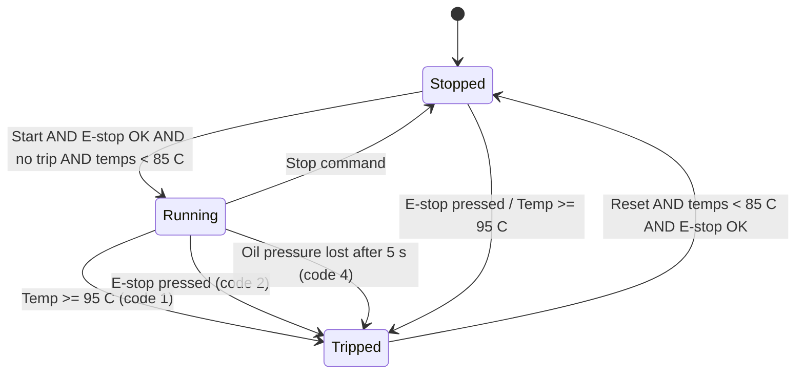
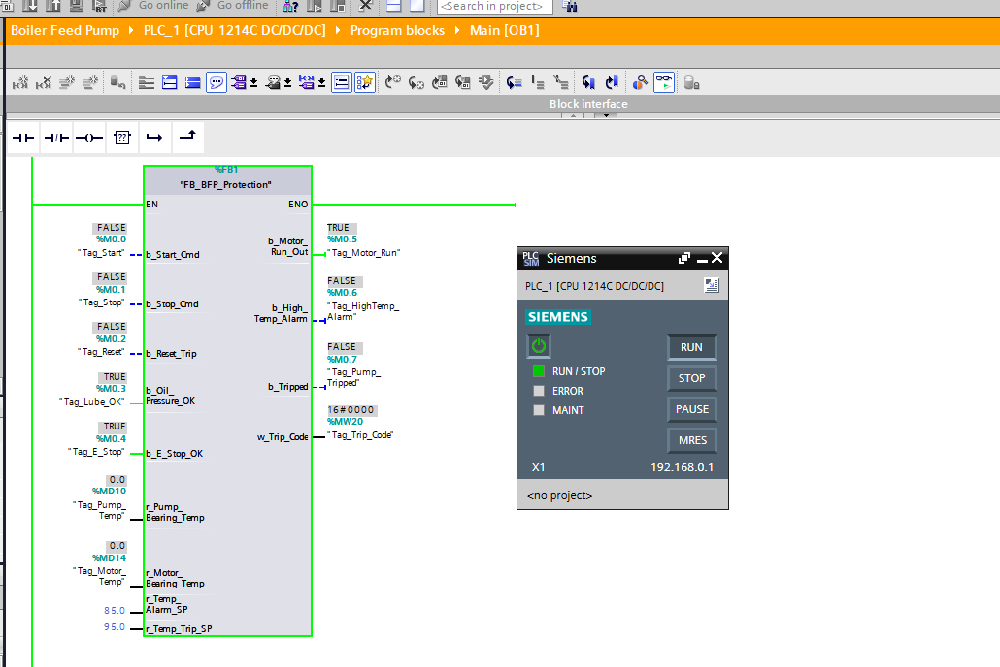
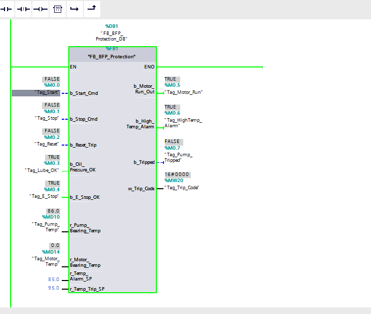
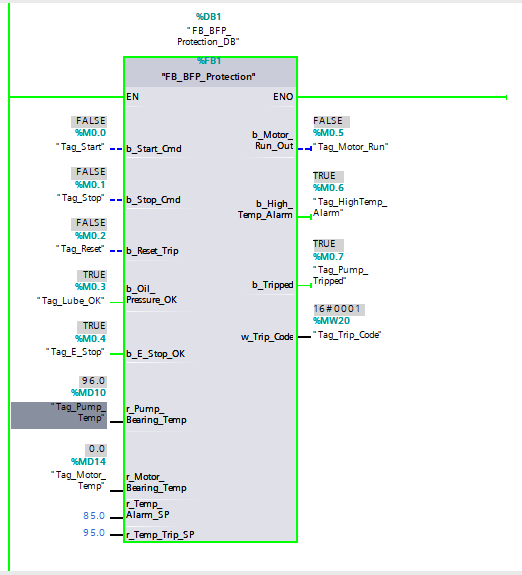
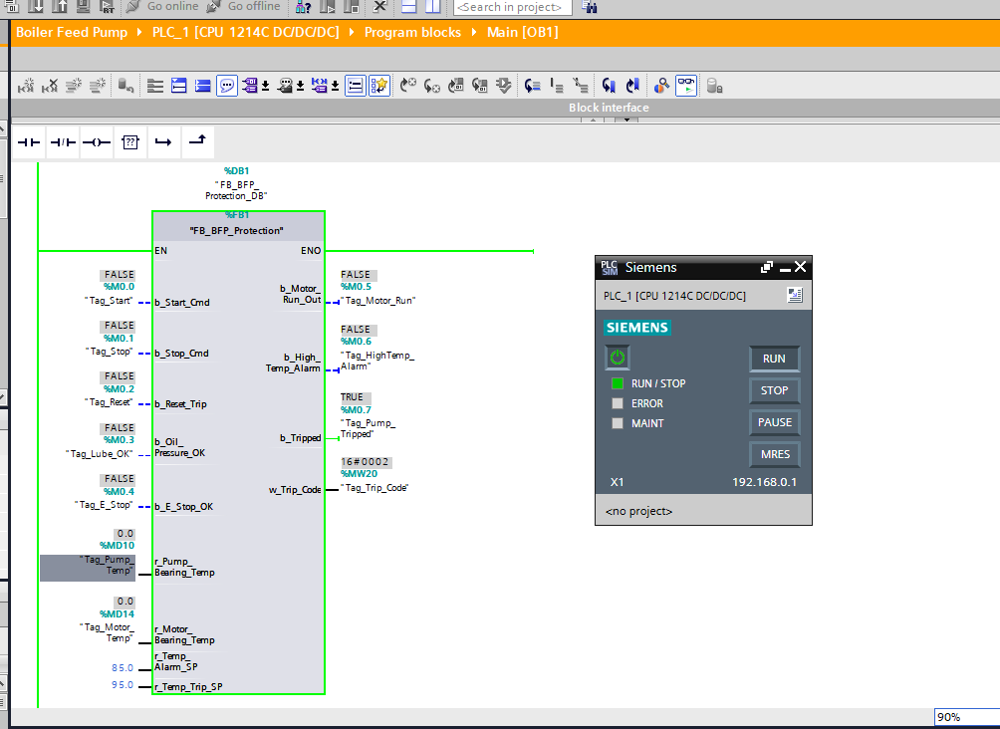
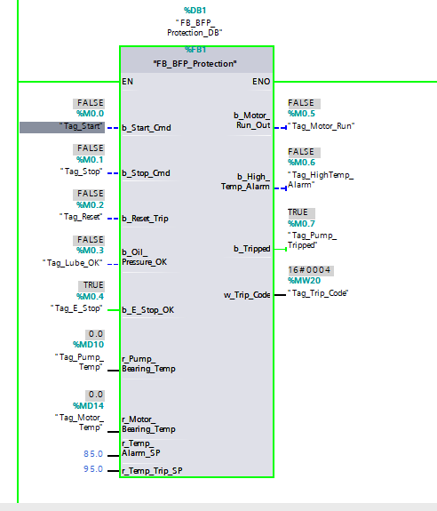

# Boiler Feed Pump (BFP) Protection - Siemens S7-1200 / SCL

A function block that protects a boiler feed pump motor against bearing
over-temperature, emergency-stop events and loss of lube-oil pressure, with a
latched trip, a conditional manual reset and trip-code reporting for an HMI.
Written in **SCL**, built in **TIA Portal V16**, verified in **S7-PLCSIM**.

| | |
|---|---|
| PLC | S7-1200, CPU 1214C DC/DC/DC |
| Software | TIA Portal V16, S7-PLCSIM |
| Language | SCL (Structured Control Language) |
| Block | `FB_BFP_Protection` [FB1], instance `FB_BFP_Protection_DB` [DB1], called from `Main [OB1]` |

## Why this exists

A feed pump forces water into a high-pressure boiler at roughly 2900 RPM. If
bearing lubrication is lost, bearing temperature rises quickly and a failure
can destroy the pump and motor. The protection must:

1. Stop the pump on a dangerous condition,
2. **Stay stopped** (latch) even if the condition disappears, because a cooling
   bearing must not trigger an automatic restart, and
3. Only restart after a deliberate operator reset.

## Plant concept

```
400 V AC  --> Power contactor --> Induction motor --> Boiler feed pump
                   ^
              Interposing relay <-- PLC output %M0.5 (b_Motor_Run_Out)   (24 V DC)
```

The PLC never switches the 400 V motor circuit directly. Its 24 V output
drives an interposing relay, which energises the contactor coil.

Field inputs: NC mushroom E-stop, Pt100 RTD bearing temperature probes (via an
analog module, scaled to degrees C), and a lube-oil pressure switch.

## Sequence of operation



- **High-temp alarm:** either bearing >= 85.0 C sets `b_High_Temp_Alarm`
  (beacon/HMI warning); the pump keeps running.
- **Trip:** either bearing >= 95.0 C trips the pump (code `16#0001`).
- **E-stop:** fail-safe. `b_E_Stop_OK = FALSE` (button pressed *or* wire
  broken) trips the pump (code `16#0002`).
- **Lube-oil grace period:** on start the oil pump has no pressure yet, so
  pressure is ignored for 5 s (`TON`). After that, loss of pressure trips the
  pump (code `16#0004`).
- **Latch and reset:** a trip stays latched until `b_Reset_Trip` is pulsed
  **and** both bearings are below the alarm setpoint **and** the E-stop is
  healthy.
- **First-fault reporting:** the code of the fault that tripped the pump first
  is kept; later faults do not overwrite it.

## Interface

| Direction | Name | Type | Tag / Address | Description |
|---|---|---|---|---|
| In | `b_Start_Cmd` | Bool | `Tag_Start` %M0.0 | Start pushbutton |
| In | `b_Stop_Cmd` | Bool | `Tag_Stop` %M0.1 | Stop pushbutton |
| In | `b_Reset_Trip` | Bool | `Tag_Reset` %M0.2 | Trip reset pushbutton |
| In | `b_Oil_Pressure_OK` | Bool | `Tag_Lube_OK` %M0.3 | TRUE = oil pressure healthy |
| In | `b_E_Stop_OK` | Bool | `Tag_E_Stop` %M0.4 | TRUE = healthy (NC circuit) |
| In | `r_Pump_Bearing_Temp` | Real | `Tag_Pump_Temp` %MD10 | Pump bearing temperature, C |
| In | `r_Motor_Bearing_Temp` | Real | `Tag_Motor_Temp` %MD14 | Motor bearing temperature, C |
| In | `r_Temp_Alarm_SP` | Real | constant 85.0 | Alarm setpoint, C |
| In | `r_Temp_Trip_SP` | Real | constant 95.0 | Trip setpoint, C |
| Out | `b_Motor_Run_Out` | Bool | `Tag_Motor_Run` %M0.5 | Run command to interposing relay |
| Out | `b_High_Temp_Alarm` | Bool | `Tag_HighTemp_Alarm` %M0.6 | High-temperature warning |
| Out | `b_Tripped` | Bool | `Tag_Pump_Tripped` %M0.7 | Trip latched |
| Out | `w_Trip_Code` | Word | `Tag_Trip_Code` %MW20 | Active trip code |
| Static | `b_Pump_Running`, `b_Trip_Latched`, `t_Oil_Lube_Timer` | Bool, Bool, TON_TIME | - | Internal state |

Trip codes: `16#0000` healthy, `16#0001` over-temperature, `16#0002` E-stop,
`16#0004` lube-oil pressure lost.

In simulation the inputs are driven from the PLCSIM watch table / forced values.
On real hardware, `Tag_Pump_Temp` and `Tag_Motor_Temp` would come from scaled
analog (RTD) inputs.

## Repository layout

```
.
├── src/FB_BFP_Protection.scl      SCL source of the function block
├── docs/images/                   PLCSIM / TIA Portal screenshots
├── LICENSE
└── README.md
```

## How to run it

1. Create an S7-1200 (CPU 1214C DC/DC/DC) project in TIA Portal V16.
2. Add a function block `FB_BFP_Protection` (SCL) with the interface above and
   paste the code from `src/FB_BFP_Protection.scl`.
3. In `Main [OB1]` call the FB with instance DB `FB_BFP_Protection_DB` and the
   tags listed in the interface table (see `docs/images/06-ob1-network.png`).
4. Compile, start S7-PLCSIM, download, and set the tag values from the test
   table below.

## Verification (PLCSIM)

| # | Scenario | Inputs | Expected | Result | Evidence |
|---|---|---|---|---|---|
| 1 | Normal start | E-stop OK, oil OK, temps 0, pulse Start | `b_Motor_Run_Out` = TRUE, no trip, code `0000` | Pass |  |
| 2 | High-temp alarm | Pump temp 86.0 | `b_High_Temp_Alarm` = TRUE, no trip | Pass |  |
| 3 | Over-temp trip | Pump temp 96.0 | `b_Tripped` = TRUE, code `0001`, motor off | Pass |  |
| 4 | E-stop trip | `b_E_Stop_OK` = FALSE | `b_Tripped` = TRUE, code `0002`, motor off | Pass |  |
| 5 | Lube-oil loss | Pump running > 5 s, oil OK = FALSE | `b_Tripped` = TRUE, code `0004`, motor off | Pass |  |


## Design notes and limitations

- Oil-pressure loss is only checked after the 5 s grace period, and the timer
  resets whenever the pump stops, so every start gets a fresh grace period.
- Reset is deliberately stricter than the trip: bearings must be below the
  *alarm* setpoint, not just the trip setpoint, to avoid chatter at the limit.
- Not implemented: Pt100 wire-break / out-of-range detection, temperature
  filtering or trip delay, and a hardware safety relay in series with the
  E-stop. A real installation needs a certified safety circuit; this logic is a
  learning/simulation project and **must not** be used as the only protection
  for real machinery.

## Possible extensions

- Analog scaling block (NORM_X / SCALE_X) for a real Pt100 module with
  open-circuit diagnostics.
- Separate alarm and trip delays, and a rate-of-rise temperature trip.
- HMI screen (WinCC Basic) showing the trip-code text.

## Author

[Dinuka Senevirathne] - Electrical and Electronic Engineer


Licensed under the MIT License.
